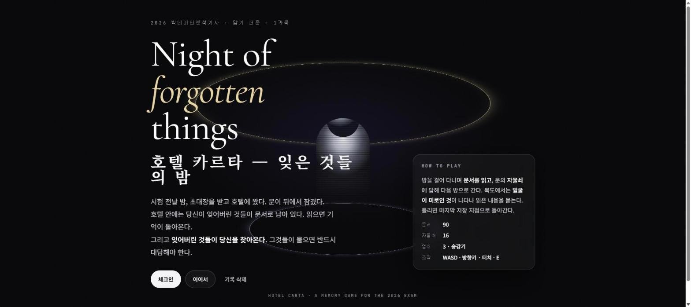
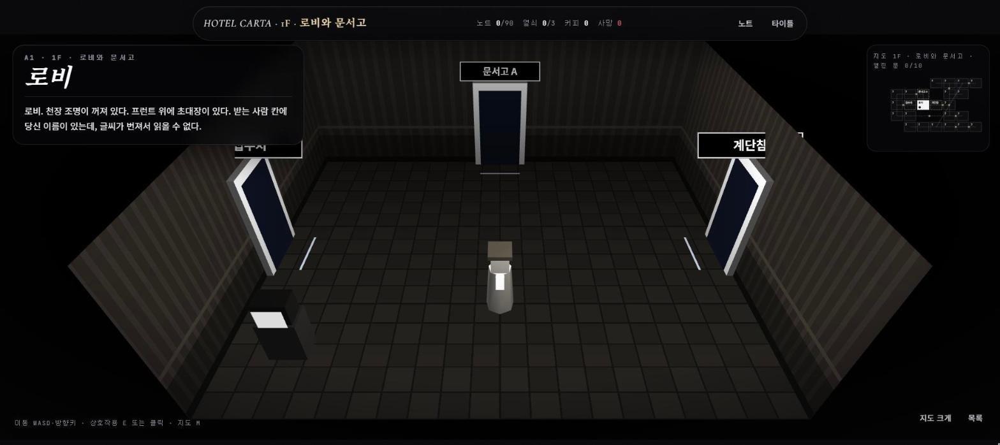

# Hotel Carta — 잊은 것들의 밤 (호텔 카르타)

2026 빅데이터분석기사 필기 1과목 개념을 외우기 위해 만든 브라우저 게임입니다. 시험 전날 밤 호텔에 갇혔다는 설정으로, 호텔 1층의 방 24개를 3D로 돌아다니며 개념 문서 90개를 읽고, 잠긴 문의 자물쇠 문제와 복도에서 나타나는 존재의 심문 문제(문항 116개)에 답해 승강기까지 갑니다.

- 바로 보기: https://develop-korea-tech.github.io/bitdata-hotel/
- 형태: 단일 HTML 파일(`index.html`) · 설치 없음 · PC(키보드·마우스)와 모바일(터치) 지원 · 인터넷 연결 필요(Three.js·글꼴)
- 기술: HTML · CSS · JavaScript(프레임워크·빌드 도구 없음) · Three.js r128(CDN, 3D 방 화면) · Canvas 2D(3D 텍스처) · SVG(지도) · Google Fonts
- 만든 시기: 2026-08 (마지막 업로드 기준)

| 타이틀 화면 | 3D 방 탐색 — 1층 로비 |
|---|---|
|  |  |

## 1. 주요 기능

방마다 짧은 설명문이 붙어 있고, 대사와 연출은 공포물 형식입니다(얼굴 없는 지배인, 오답 시 총소리와 「BANG」 화면 등). 학습 내용은 문서와 문항으로 나뉘며, 문항은 모두 특정 문서(개념)를 근거로 합니다.

### 1-1. 진행 순서

1. 첫 화면에서 「체크인」을 누르면 지배인의 도입 대사(9줄)가 나온 뒤 로비에서 시작합니다.
2. 방에 놓인 책상 위 문서를 읽습니다. 문서 화면을 「덮는다」로 닫으면 노트에 기록되고, 상단 바의 「노트 n/90」이 늘어납니다.
3. 잠긴 문(지도의 ⚿ 표시)으로 가면 자물쇠 문제가 나옵니다. 문마다 정해진 단원의 문항 중 하나가 나오고, 맞히면 문이 열립니다. 자물쇠에서는 틀려도 죽지 않고 오답으로만 기록됩니다.
4. 문서를 6개 이상 읽은 뒤 복도형 방(5곳)에 들어가면 28% 확률로 얼굴이 미로 모양인 존재(화면 표시 "빈칸 · NULL")가 나타나 다가옵니다. 닿으면 제한시간이 있는 심문 문제가 나오고, 틀리거나 시간이 끝나면 사망합니다. 사망하면 마지막으로 저장한 컴퓨터가 있는 방에서 다시 시작하며, 읽은 문서·연 문·열쇠·오답 기록은 그대로 남습니다.
5. 열쇠 3개(타자실·금고실·호수의 방)를 모으면 임시 저장소와 승강기 홀 사이의 문이 열리고, 승강기를 타면 클럽(마지막 관문)으로 갑니다.
6. 클럽에서는 전체 문항 중 12문항이 연속으로 나옵니다(오답 기록이 있는 문항이 먼저). 하나라도 틀리면 로비로 돌아가고, 「목숨을 구걸한다」를 누르면 승강기 홀로 돌아갑니다. 12문항을 모두 맞히면 「1층 통과」 화면이 나옵니다. 2층(통계)은 "다음 빌드에서 열린다"는 안내만 있습니다.

### 1-2. 과목·단원별 문서와 문항 수

코드에 들어 있는 내용은 1과목뿐입니다(`ATOMS` 주석 "1과목 (90개)", 타이틀 문구 "1과목"). 1과목은 다섯 단원(코드 `1_1`~`1_5`, 화면에는 `1.1`~`1.5`로 표시)으로 나뉩니다.

| 단원 코드 | 주제(코드 주석) | 단원 제목(`QBANK`) | 문서 | 문항 | 문서가 있는 방 |
|---|---|---|---:|---:|---|
| `1_1` | 1화 데이터·DB | 엑셀부터 하라고? | 13 | 17 | 접수처, 문서고 A, 계단참 |
| `1_2` | 2화 빅데이터 개념 | 빅데이터가 뭔데 | 23 | 29 | 서관 복도, 열람실, 세면장, 전시실, 암실 |
| `1_3` | 3화 분석 기획 I | 기획서를 쓴다는 것 | 20 | 24 | 동관 복도, 회의실, 기획실, 지도실, 타자실 |
| `1_4` | 4화 분석 기획 II | 준비된 회사, 성숙한 회사 | 15 | 20 | 2층 홀, 성숙의 방, 준비의 방, 금고실 |
| `1_5` | 5화 수집·저장 | 창고와 호수 | 19 | 26 | 하역장, 창고, 호수의 방, 서버실, 임시 저장소 |
| 합계 | | | 90 | 116 | 22개 방 |

문서 90개에는 모두 문항이 1개 이상 연결되어 있습니다.

### 1-3. 문항(퍼즐) 유형

문항 화면 위쪽 태그에 유형 이름(`TN` 상수)이 표시됩니다. 카드·조각·항목·후보는 매번 섞어서 보여 주고, 사지선다 보기와 O/X 버튼은 정해진 순서대로 보여 줍니다.

| 유형 코드 | 화면 표시 | 푸는 방법 | 1_1 | 1_2 | 1_3 | 1_4 | 1_5 | 합계 |
|---|---|---|---:|---:|---:|---:|---:|---:|
| `mc` | 사지선다 | 보기 ①~④ 중 하나를 누릅니다(키 `1`~`4`) | 6 | 8 | 7 | 7 | 11 | 39 |
| `order` | 순서 | 카드를 순서대로 눌러 늘어놓고 「제출」(「비우기」로 초기화) | 3 | 6 | 5 | 2 | 2 | 18 |
| `bucket` | 분류 | 항목을 누른 뒤 들어갈 칸을 누르고 「제출」. 넣은 항목을 누르면 빠집니다 | 3 | 4 | 2 | 3 | 5 | 17 |
| `match` | 짝잇기 | 후보를 누른 뒤 왼쪽 항목 옆 빈칸을 누르고 「제출」 | 3 | 4 | 3 | 1 | 3 | 14 |
| `piece` | 글자 조합 | 글자 조각을 순서대로 눌러 암기어를 만들고 「제출」. 오답 조각이 섞여 있습니다 | 1 | 3 | 2 | 4 | 0 | 10 |
| `trap` | 진위 | 진술을 읽고 O(맞는 말) 또는 X(틀린 말)를 누릅니다(키 `O`·`X`) | 1 | 3 | 3 | 2 | 1 | 10 |
| `flow` | 빈칸 | 흐름·포함 관계의 빈칸에 후보를 넣고 「제출」. 오답 후보가 섞여 있습니다 | 0 | 1 | 0 | 0 | 4 | 5 |
| `grid` | 사분면 | 항목을 누른 뒤 2×2 사분면 칸을 누르고 「제출」 | 0 | 0 | 2 | 1 | 0 | 3 |
| `calc` | 계산 | 숫자를 입력하고 「제출」 | 0 | 0 | 0 | 0 | 0 | 0 |
| 합계 | | | 17 | 29 | 24 | 20 | 26 | 116 |

`order`·`piece`·`bucket`·`match`·`flow`·`grid`는 모든 칸을 채워야 「제출」 버튼이 눌립니다. `calc`(계산)는 화면 처리·판정 코드만 있고 문항은 없습니다.

### 1-4. 방 안의 상호작용 대상

| 대상 | 지도 표시 | 있는 곳 | 동작 |
|---|---|---|---|
| 문서 | — | 22개 방(로비·승강기 홀 제외) | 문서 화면을 엽니다. 「덮는다」를 누르면 노트에 기록됩니다 |
| 문 | 연결선(잠긴 문은 ⚿) | 모든 방 | 열린 문은 이동, 잠긴 문은 자물쇠 문제 |
| 컴퓨터 | ● | 로비, 암실, 성숙의 방, 서버실 | 이 방을 저장 지점(사망 후 다시 시작하는 방)으로 정합니다 |
| 커피 머신 | ☕ | 서관 복도, 지도실, 호수의 방 | 커피 +1. 커피 1잔마다 심문 제한시간 +10초, 클럽 제한시간 +8초 |
| 열쇠 | ⚷ | 타자실, 금고실, 호수의 방 | 열쇠를 줍습니다(승강기 열쇠 n/3) |
| 승강기 | ▲ | 승강기 홀 | 열쇠 3개면 클럽으로 갑니다 |

유령은 복도형 방(계단참, 서관 복도, 동관 복도, 2층 홀, 하역장)에만 나타납니다.

### 1-5. 학습 보조 기능

- 문서 한 장에는 제목, 한 줄 요약, 개념 노트, 암기법("여백에 누가 써 놓은 암기법")과 ★(출제)·⚠(낚시) 표시가 들어 있습니다. 문서 90개 중 ★ 24개, ⚠ 7개, 암기법 31개입니다.
- 자물쇠 문제의 근거 문서를 아직 읽지 않았으면 문제 위에 안내가 나오고, 그 문서가 있는 방 이름을 알려 줍니다. 읽지 않고 바로 시도할 수도 있습니다.
- 답을 내면 해설이 나오고, 틀리면 정답도 함께 보여 줍니다. 자물쇠에서 틀리면 「문서 「…」 다시 읽기」와 「다른 자물쇠 문항으로 다시」 버튼이 나옵니다.
- 틀린 문항은 오답 목록(`P.wrong`)에 쌓이고, 자물쇠(40% 확률)·심문(50% 확률)·클럽(가장 먼저)에서 우선 출제됩니다.
- 노트 화면(상단 바 「노트」)에서는 틀린 문서를 맨 위에 모아 보여 주고, 단원별로 읽은 문서의 요약·암기법·전문을 다시 볼 수 있습니다. 읽지 않은 문서는 제목만 흐리게 보입니다.

## 2. 조작 방법

### 2-1. PC (키보드·마우스)

| 입력 | 동작 |
|---|---|
| `W` `A` `S` `D` 또는 방향키 | 이동 |
| `E`, `Enter`, `Space` | 가까운 대상과 상호작용(화면 아래 가운데에 「E 문서를 읽는다 · …」 같은 안내가 보일 때) |
| 3D 화면에서 물체 클릭 | 가까우면 바로 상호작용하고, 멀면 그쪽으로 걸어갑니다 |
| 3D 화면에서 바닥 클릭 | 그 지점으로 걸어갑니다 |
| 오른쪽 위 지도에서 이웃 방 클릭 | 그 방으로 이동합니다(잠긴 문이면 자물쇠 문제) |
| `M` 또는 「지도 크게」 버튼 | 지도 크게/작게 |
| 「목록」 버튼 | 현재 방의 문서·문·상호작용을 버튼 목록으로 봅니다(「3D로 돌아간다」로 복귀) |
| 자막(대사) 화면에서 클릭, `Enter`, `Space` | 다음 줄 |
| 문제 화면에서 `1`~`4` | 사지선다 보기 선택 |
| 문제 화면에서 `O` / `X` | 진위 문제 O / X 선택 |
| 문제 화면에서 `Enter` | 「제출」, 또는 답을 낸 뒤의 다음 버튼(「문을 연다」, 「돌아간다」, 「다음 갈림길」 등) |

키 판정은 `event.key` 값(`w` `a` `s` `d` `e` `m`, `o` `x`)으로 합니다. 문자 키가 반응하지 않으면 한/영 키로 영문 입력 상태로 바꾸거나 방향키를 쓰십시오. 문서 화면의 「덮는다」, 자물쇠의 「물러난다」 등 그 밖의 버튼은 마우스로 누릅니다.

### 2-2. 모바일 (터치)

| 입력 | 동작 |
|---|---|
| 왼쪽 아래 방향 패드 ▲ ◀ ▶ ▼ | 누르고 있는 동안 이동 |
| 방향 패드 가운데 `E` | 가까운 대상과 상호작용 |
| 3D 화면 탭 | PC의 클릭과 같습니다(물체 상호작용 또는 그 지점으로 이동) |
| 지도·버튼 탭 | PC의 클릭과 같습니다 |

방향 패드는 마우스처럼 정밀한 포인터가 없는 기기(CSS `(hover:hover) and (pointer:fine)`에 해당하지 않는 기기)에서만 보입니다. 화면 폭 820px 이하에서는 글자·지도 크기를 줄인 배치로 바뀝니다.

## 3. 실행 방법

### 3-1. 인터넷에서 바로 보기

1. 크롬 등 브라우저에서 https://develop-korea-tech.github.io/bitdata-hotel/ 을 엽니다.
2. 첫 화면에서 「체크인」을 누릅니다.
3. 도입 대사 9줄이 차례로 나옵니다. 화면을 클릭하거나 `Enter`(또는 `Space`)를 눌러 넘깁니다.
4. 로비(3D 화면)에서 시작합니다. 화면 아래 안내 문구와 오른쪽 위 지도를 보며 문서가 있는 방으로 갑니다. 로비에서 잠금 없이 갈 수 있는 방은 접수처·문서고 A·계단참입니다.
5. 상단 바의 「타이틀」로 첫 화면에 돌아갈 수 있고, 같은 탭에서는 「이어서」로 하던 곳부터 계속합니다. 「기록 삭제」는 진행 상황을 처음 상태로 되돌립니다.
6. 진행 상황은 브라우저에 저장되지 않습니다(5-9 참고). 새로고침하거나 탭을 닫으면 처음부터 다시 시작합니다.

### 3-2. 내 PC에서 실행하기

1. 저장소 페이지 위쪽의 초록색 **Code** 버튼 → **Download ZIP**을 누릅니다.
2. 내려받은 ZIP 파일(`bitdata-hotel-main.zip`)을 마우스 오른쪽 버튼 → **압축 풀기**(또는 "모두 추출")로 풉니다.
3. 풀린 폴더(`bitdata-hotel-main`)에서 `index.html`을 더블클릭합니다. 기본 브라우저에서 열립니다(크롬 권장).
4. 이후 진행은 3-1의 2번부터와 같습니다.
5. 주의사항
   - 인터넷 연결이 필요합니다. 3D 화면에 쓰는 Three.js r128을 cdnjs.cloudflare.com에서, 글꼴(Cormorant Garamond, Noto Serif KR, Noto Sans KR, JetBrains Mono)을 Google Fonts에서 불러옵니다.
   - 인터넷이 없으면 글꼴은 기본 글꼴로 보입니다. Three.js도 불러오지 못하므로, 코드상 3D 화면 대신 방 정보를 버튼으로 보여 주는 목록 화면으로 진행됩니다(6장 참고).
   - 외부 파일을 따로 읽어 오지 않으므로 로컬 서버 없이 더블클릭으로 열면 됩니다.
   - 소리는 없습니다(코드에 오디오 재생 부분이 없습니다).
   - PC 화면 기준으로 만들어졌고, 화면 폭 820px 이하에서는 모바일용 배치로 바뀝니다.

## 4. 파일 구성

| 파일 | 설명 |
|---|---|
| `index.html` | 게임 전체가 들어 있는 단일 파일(152,099바이트, 969줄). 마크업·CSS·데이터·게임 로직을 모두 포함합니다 |
| `README.md` | 이 문서 |

`index.html` 내부 구성(현재 줄 번호 기준):

| 줄 | 내용 |
|---|---|
| 1–3 | `<head>`: 제목, viewport, Three.js r128 `<script>` |
| 4–202 | `<style>`: Google Fonts `@import`, 색상 변수(`:root`), 화면별 스타일, 820px 이하 반응형 규칙 |
| 203–243 | 화면 마크업: 상단 바 `#bar`, 타이틀 `#s-title`, 탐색 `#s-explore`(3D 캔버스 `#gl`, HUD, 목록 `#room`), 노트 `#s-note`, 오버레이 `#ov` |
| 244–564 | 첫 번째 `<script>`: 데이터 — `ATOMS`(문서 90개), `QBANK`(문항 116개), `FLOOR`(방·연결), `NULLS`, `CLERK`(대사) |
| 565–967 | 두 번째 `<script>`: 게임 로직(즉시 실행 함수 하나) — 상태 `P`, 화면 전환, 지도, 3D(`W3`), 문항 렌더링·판정, 자물쇠, 심문, 클럽, 노트 |

## 5. 작동 원리

### 5-1. 전체 흐름

```
페이지 로드 → load() → bar()

타이틀 화면 #s-title
 ├ 「체크인」 #b-new  : 상태 P 초기화 → enter()
 └ 「이어서」 #b-cont : 지금의 P 그대로 → enter()
     enter(): 처음이면 caption(CLERK.intro) 다음 roomView(), 아니면 바로 roomView()

탐색 화면 #s-explore
 roomView() → W3.build(): 현재 방(P.pos)을 3D로 새로 만듦
     (Three.js가 없으면 roomListView()로 목록 화면을 그림)
 W3.loop(): 매 프레임 이동, 가까운 물체 찾기, 카메라, 유령, 렌더링
 W3.act() / 클릭 / 목록 버튼
 ├ 문서: readDoc() → 「덮는다」 → P.read에 추가
 ├ 열린 문: tryMove() → P.pos 변경 → roomView()
 │   └ 복도형 방 + 문서 6개 이상 + 28% 확률 → 0.7초 뒤 W3.spawnGhost()
 ├ 잠긴 문: openLock()
 │   ├ 정답 → P.opened에 추가 → 「문을 연다」로 이동
 │   └ 오답 → P.wrong에 추가 (사망 없음)
 ├ 컴퓨터: P.saveAt = 현재 방
 ├ 커피 머신: P.cof + 1
 ├ 열쇠: P.keys에 추가
 └ 승강기: 열쇠 3개면 enterClub()
 유령과 닿음 → interro()
 ├ 정답 → 계속
 └ 오답·시간 초과 → die() → P.saveAt 방에서 다시 시작
 enterClub() → 12문항
 ├ 모두 정답 → finalScreen()
 └ 하나라도 오답 → 로비(A1)로

노트 화면 #s-note → noteView()
```

### 5-2. 화면 구성

| 영역 | 요소 | 내용 |
|---|---|---|
| 타이틀 | `#s-title` | 영문·한글 제목, 「체크인」(`#b-new`)·「이어서」(`#b-cont`)·「기록 삭제」(`#b-wipe`), How to play 카드 |
| 상단 바 | `#bar` | 층 이름, 노트·열쇠·커피·사망 수, 「노트」(`#go-note`)·「타이틀」(`#go-title`). 타이틀 화면에서는 숨깁니다 |
| 탐색(3D) | `#stage` | 3D 캔버스 `#gl`, 방 코드·이름·설명(`.hud-top`), 상호작용 안내(`#h-prompt`), 지도(`#h-map`), 「지도 크게」·「목록」, 방향 패드(`#dpad`), 조작 도움말 |
| 탐색(목록) | `#room` | `roomListView()`가 그리는 버튼 목록: 문서(읽음 여부·★⚠), 문(열림 또는 자물쇠 단원), 상호작용 |
| 노트 | `#s-note` | `noteView()`가 그리는 오답 모음과 단원별 문서 목록 |
| 오버레이 | `#ov` | 자막(`.cap`), 문서·자물쇠·결과 시트(`.paper .sheet`), 심문·클럽(`.interro`), 사망 연출(`.bang`) |

화면 전환은 `show(id)`가 세 `<section>`의 `hide` 클래스를 바꾸는 방식이고, 대사·문서·문제는 모두 `#ov`에 HTML을 넣었다가 비우는 방식으로 띄웁니다. 색은 `:root`의 CSS 변수로 정의하며, 검은 배경(`--bg` `#050507`)과 흰 글자(`--ink` `#F4F4F6`)를 기본으로 금색(`--glow`)·청색(`--cool`)·붉은색(`--danger`)을 강조색으로 씁니다. 화면 전체에 SVG 노이즈 무늬를 옅게 겹치고(`#hc::before`), 3D 화면 가장자리는 어둡게 처리합니다(`.stage::after`).

### 5-3. 상태 관리

게임 상태는 객체 `P` 하나에 모여 있습니다.

| 필드 | 내용 |
|---|---|
| `pos` | 현재 방 ID(예: `"A1"`) |
| `read` | 읽은 문서 ID 배열(예: `"1-07"`) |
| `opened` | 연 자물쇠 목록. 두 방 ID를 정렬해 이은 키(`linkKey()`, 예: `"A2-B1"`) |
| `keys` | 주운 열쇠(`"key1"`~`"key3"`) |
| `cof` | 마신 커피 수. 심문에서 사망하면 0이 됩니다 |
| `die` | 사망 횟수(노트 화면에는 "결측"으로 표시) |
| `seen` | 도입 대사를 봤는지 여부 |
| `wrong` | 틀린 문항 ID 배열(`"단원코드#순번"`, 예: `"1_1#3"`) |
| `saveAt` | 마지막으로 저장한 방 ID(처음 값 `"A1"`) |
| `visited` | 들른 방 ID(지도에 방 이름을 보여 줄지 판단) |
| `club` | 클럽 통과 시 1로 설정(읽는 곳은 없음) |
| `fast`, `heat` | `fast`는 선언만 있고, `heat`는 자물쇠 오답 때 1씩 늘지만 읽는 곳이 없음 |

### 5-4. 메인 루프 (`W3.loop()`)

`requestAnimationFrame`으로 매 프레임 실행되며, 방이 없거나 탐색 화면이 숨겨져 있으면 건너뜁니다.

1. 눌린 키(`W3.keys`) 또는 클릭한 목표 지점(`W3.walkTo`)으로 이동 방향을 정하고, 한 프레임에 0.075씩 움직입니다. 위치는 방 안(x ±4.6, z ±3.6)으로 제한합니다.
2. 1.9 거리 안에서 가장 가까운 물체를 `W3.near`로 정하고 `#h-prompt`에 안내 문구를 표시합니다.
3. 카메라가 목표 위치(플레이어 좌표의 0.35배 지점에서 앞쪽으로 7.5)로 매 프레임 남은 거리의 6%씩 다가갑니다.
4. 유령이 있으면 매 프레임 플레이어 쪽으로 남은 거리의 1.2%씩 다가오고, 거리 0.9 안으로 들어오면 유령을 지우고 `interro()`를 호출합니다.
5. 천장 조명(`W3.lamp`)의 밝기를 조금씩 흔들고, 약 3% 확률로 순간 어둡게 합니다.
6. `W3.rnd.render()`로 장면을 그립니다.

### 5-5. 3D 화면 (Three.js r128)

- `W3.init()`: 렌더러(`#gl`, 픽셀 비율 최대 1.5), 검은 배경과 안개(거리 8~19), 원근 카메라(시야각 46°), 플레이어 모형(원기둥 몸통·상자 머리·모자), 조명(전체 조명, 천장 점조명, 플레이어를 따라다니는 점조명 2개)을 만들고 키보드·방향 패드·캔버스 클릭·HUD 버튼 이벤트를 등록합니다. 바닥(체크무늬)·벽(세로 줄)·천장(격자) 텍스처는 `W3.tex()`가 Canvas 2D로 그려 만들고, 확대해도 픽셀이 보이도록 `NearestFilter`를 씁니다.
- `W3.build()`: 이전 방을 지우고(`W3.clearRoom()`) 현재 방을 가로 10 × 세로 8, 높이 3.4 크기로 새로 만듭니다. 카메라는 방 앞쪽 위(높이 7.2)에서 비스듬히 내려다봅니다.
  - 문: 이웃 방의 지도 좌표 방향에 있는 벽에 놓습니다(한 벽에 2개까지). 열린 문은 밝은 문틀과 청색 조명, 잠긴 문은 어두운 문틀과 금색 패드로 구분하고, 문 위에 방 이름표(`W3.label()`, 잠긴 문은 ⚿)를 붙입니다.
  - 문서: 방 가운데를 둘러싼 책상 위의 종이입니다. 안 읽은 문서는 흰 종이에 조명이 있고, 읽은 문서는 회색입니다.
  - 컴퓨터·커피 머신은 화면 왼쪽 아래 구석, 열쇠는 오른쪽 위의 받침대, 승강기는 안쪽 벽 가운데(열쇠 표시등 3개)에 둡니다.
  - 플레이어는 들어온 문 앞에 세웁니다.
- 각 물체에는 `userData.obj`로 `{kind, label, …}` 정보를 붙여 두고, 근접 판정과 클릭 판정(`THREE.Raycaster`)에 씁니다.
- `W3.spawnGhost()`: 검은 원기둥 몸통·상자 머리·"▦" 이름표·청색 조명으로 된 유령을 방의 왼쪽 또는 오른쪽 벽 근처에 만듭니다. 유령은 방 그룹 안에 들어 있으므로, 닿기 전에 다른 방으로 이동하면 `W3.clearRoom()`이 함께 지웁니다.

### 5-6. 데이터 구조

**문서(`ATOMS`)** — `A(id, st, t, s, n, m, k)`로 만듭니다.

```js
A("1-07","1_1","데이터베이스 4특징","공용·통합·저장·변화(무결성 유지).",
  "공용: 여러 부서가 다른 목적으로 함께 쓴다. …","공통접변","★")
// id, 단원 코드, 제목, 한 줄 요약, 개념 노트(여기서는 줄임), 암기법, 표시(★출제 ⚠낚시)
```

**문항(`QBANK`)** — 단원별 객체 `{code, name, star, ch, qs}` 5개이고, `qs`에 아래 함수로 만든 문항이 들어 있습니다. 모든 문항은 유형(`t`), 근거 문서 ID(`atom`), 질문(`q`), 해설(`e`)을 가집니다. 페이지가 열릴 때 각 문항에 `id`(`"1_1#0"` 형식), `stage`, `sname`을 붙이고, 단원 코드로 찾는 `BANK`를 만듭니다. `star`, `ch`는 읽는 곳이 없습니다.

| 함수 | 유형 | 정답 데이터 |
|---|---|---|
| `MC(at, q, c, a, e)` | `mc` | `c` 보기 4개, `a` 정답 번호(0부터) |
| `OR(at, q, items, e)` | `order` | `items` 정답 순서(화면에서는 섞어서 보여 줌) |
| `BK(at, q, b, items, e)` | `bucket` | `b` 칸 이름, `items` `[항목, 칸 번호]` |
| `GR(at, q, cells, items, e)` | `grid` | `cells` 사분면 4칸 이름(좌상·우상·좌하·우하 순), `items` `[항목, 칸 번호]` |
| `MT(at, q, L, R, e)` | `match` | `L[i]`와 `R[i]`가 정답 짝 |
| `PC(at, q, ans, extra, e)` | `piece` | `ans` 정답 문자열(한 글자씩 조각으로 나눔), `extra` 오답 조각 |
| `TR(at, stmt, truth, e)` | `trap` | `truth` 진술의 참/거짓 |
| `FL(at, q, slots, pool, e)` | `flow` | `slots` `[칸 이름, 정답]`, `pool` 오답 후보 |
| `CA(at, q, ans, tol, unit, e)` | `calc` | `ans` 정답 수, `tol` 허용 오차 — 쓰는 문항 없음 |

```js
MC("1-12","'고객 테이블에서 울산 거주자만 뽑아줘'를 컴퓨터가 이해하게 쓰려면 어떤 언어를 쓰는가?",
   ["Python","SQL","HTML","JSON"],1,"DB 접근을 위한 국제 표준 언어 SQL.")
```

**층(`FLOOR`)**

```js
FLOOR = {
  name: "1F · 로비와 문서고", start: "A1",
  rooms: { A1: {x:3, y:2, n:"로비", pc:1, d:"…", docs:[]}, … },        // 방 24개
  links: [["A1","A2"], …, ["A2","B1","1_1"], …, ["E5","F1","keys3"]]  // 연결 25개
}
```

- `rooms`: `x`, `y`는 지도 칸 좌표, `n`은 이름, `d`는 설명, `docs`는 이 방의 문서 ID입니다. 선택 속성으로 `pc`(컴퓨터), `coffee`(커피 머신), `cor`(복도형: 유령 출현), `key`(열쇠 ID), `elev`(승강기)가 있습니다.
- `links`: 두 방을 잇는 문입니다. 세 번째 값이 있으면 잠긴 문이고, 단원 코드면 그 단원 문항으로 열며 `"keys3"`이면 열쇠 3개가 있어야 열립니다.

**대사** — `CLERK`는 `intro`(도입 9줄), `elevNo`(열쇠 부족), `club`, `clubWin`, `clubDie`, `dead` 대사를 `[화자, 대사]` 배열로 가집니다(화자가 빈 문자열이면 지문). `NULLS`는 심문 화면의 유령 대사 6개이며, 심문마다 무작위로 1개를 보여 줍니다.

### 5-7. 지도와 자물쇠 배치

방 ID의 영문자가 구역이고, 구역마다 한 단원의 문서가 놓여 있습니다.

| 구역 | 방(ID) | 문서 | 특수한 방 |
|---|---|---|---|
| A | 로비(A1), 접수처(A2), 문서고 A(A3), 계단참(A4) | 1-01~1-13 (`1_1`) | 로비: 시작 위치·컴퓨터 / 계단참: 복도형 |
| B | 서관 복도(B1), 열람실(B2), 세면장(B5), 전시실(B3), 암실(B4) | 1-14~1-36 (`1_2`) | 서관 복도: 복도형·커피 / 암실: 컴퓨터 |
| C | 동관 복도(C1), 회의실(C2), 기획실(C3), 지도실(C4), 타자실(C5) | 1-37~1-56 (`1_3`) | 동관 복도: 복도형 / 지도실: 커피 / 타자실: 열쇠 |
| D | 2층 홀(D1), 성숙의 방(D2), 준비의 방(D3), 금고실(D4) | 1-57~1-71 (`1_4`) | 2층 홀: 복도형 / 성숙의 방: 컴퓨터 / 금고실: 열쇠 |
| E | 하역장(E1), 창고(E2), 호수의 방(E3), 서버실(E4), 임시 저장소(E5) | 1-72~1-90 (`1_5`) | 하역장: 복도형 / 호수의 방: 열쇠·커피 / 서버실: 컴퓨터 |
| F | 승강기 홀(F1) | 없음 | 승강기 |

`FLOOR.links` 25개 중 잠긴 문은 10개입니다.

| 잠긴 문 | 여는 조건 |
|---|---|
| 접수처 ↔ 서관 복도 | `1_1` 문항 |
| 문서고 A ↔ 세면장 | `1_1` 문항 |
| 계단참 ↔ 동관 복도 | `1_2` 문항 |
| 암실 ↔ 지도실 | `1_2` 문항 |
| 지도실 ↔ 타자실 | `1_3` 문항 |
| 회의실 ↔ 2층 홀 | `1_3` 문항 |
| 준비의 방 ↔ 금고실 | `1_4` 문항 |
| 준비의 방 ↔ 하역장 | `1_4` 문항 |
| 서버실 ↔ 임시 저장소 | `1_5` 문항 |
| 임시 저장소 ↔ 승강기 홀 | 열쇠 3개 |

로비에서 접수처·문서고 A·계단참으로는 잠금 없이 갈 수 있고, `1_1`~`1_4` 단원은 자물쇠가 2개씩 있어 들어가는 경로를 고를 수 있습니다. 예를 들어 계단참 ↔ 동관 복도(`1_2`)는 `1_1` 자물쇠를 열지 않아도 시도할 수 있습니다.

지도(`drawMap()`)는 SVG에 방을 48×40 크기 칸으로 그립니다. 현재 방은 흰색, 이웃 방은 점선 테두리(누르면 이동), 들른 방·문서를 읽은 방·저장한 방은 밝게 그리고, 그 밖의 방은 이름 대신 "?"로 표시합니다. 아직 열지 않은 잠긴 연결선은 점선과 ⚿로 그리고, 지도 제목에 "열린 문 n/10"을 보여 줍니다.

### 5-8. 출제와 판정

- 자물쇠(`openLock()` → `poolOf()`): 열린 문만으로 갈 수 있는 방(`reachable()`, 깊이 우선 탐색)에 근거 문서가 있는 그 단원 문항을 후보로 합니다. 그런 문항이 없으면 그 단원 전체가 후보입니다. 후보 중 틀린 적 있는 문항이 있으면 40% 확률로 그 문항들만 남기고, 섞은 뒤 첫 문항을 냅니다.
- 심문(`interro()`): 읽은 문서에 연결된 문항을 후보로 합니다(4개 미만이면 갈 수 있는 방의 문항을 더함). 50% 확률로 틀린 적 있는 문항에서 고릅니다.
- 클럽(`enterClub()`): 전체 116문항 중 틀린 적 있는 문항을 앞에, 나머지를 뒤에 각각 섞어 놓고 앞의 12개를 냅니다.
- 제한시간(자물쇠에는 제한시간이 없습니다):

| 상황 | 사지선다·진위 | 계산 | 그 밖의 유형 | 커피 1잔당 |
|---|---:|---:|---:|---:|
| 심문 | 14초 | 45초 | 32초 | +10초 |
| 클럽 | 18초 | 50초 | 36초 | +8초 |

- 판정(`judge()`): 사지선다·진위는 고른 값, 순서는 고른 순서, 글자 조합은 이어 붙인 문자열, 분류·사분면은 모든 항목의 칸 번호, 짝잇기·빈칸은 칸마다 넣은 값을 정답과 비교합니다(계산은 허용 오차 `tol`, 기본 0.01). 답을 내면 `markMC()`가 정답·오답을 표시하고 입력을 막으며, 결과 영역에 해설(`e`)과 정답(`fmtAns()`)을 보여 줍니다.

### 5-9. 저장 방식

```js
var KEY="hotel_carta_v1";
function save(){try{if(window.storage&&window.storage.set)window.storage.set(KEY,JSON.stringify(P),false);}catch(e){}}
```

- 저장 키는 `hotel_carta_v1`이고, 상태 객체 `P` 전체를 JSON 문자열로 저장합니다. 이동·문서 읽기·자물쇠·커피·열쇠·컴퓨터 저장·사망 등 상태가 바뀔 때마다 `save()`를 부릅니다.
- `load()`는 `window.storage.get(KEY, false)`로 읽어 `P`에 처음부터 있던 키만 덮어씁니다. 2.5초 안에 응답이 없으면 기본 상태로 시작합니다.
- `localStorage`, `sessionStorage`, IndexedDB, 쿠키는 쓰지 않습니다.
- `window.storage`는 브라우저 표준 API가 아니어서 일반 브라우저에는 없습니다. 그래서 GitHub Pages나 내려받은 파일로 열면 `save()`는 아무 일도 하지 않고 `load()`는 바로 기본 상태로 시작합니다. 진행 상황은 페이지가 열려 있는 동안 메모리(`P`)에만 남습니다.
- 게임 안의 컴퓨터 저장은 이 경우에도 같은 탭 안에서 사망 후 다시 시작할 방(`P.saveAt`)을 정하는 기능으로 동작합니다.

### 5-10. 주요 함수

| 함수 | 역할 |
|---|---|
| `show(id)` | 타이틀·탐색·노트 화면 전환, 상단 바 표시 여부 |
| `bar()` | 상단 바 숫자(노트·열쇠·커피·사망) 갱신 |
| `caption(lines, done)` | 대사 자막을 한 줄씩 표시하고, 끝나면 `done()` 호출 |
| `drawMap()` | SVG 지도를 그리고 이웃 방 클릭 이동을 연결 |
| `roomView()` | 현재 방을 3D로 표시(`W3.build()`) |
| `roomListView()` | 현재 방을 버튼 목록으로 표시 |
| `W3.init()` / `W3.build()` / `W3.loop()` | 3D 초기화 / 방 만들기 / 매 프레임 갱신 |
| `W3.act()` | 가까운 물체의 종류(`kind`)에 따라 동작 실행 |
| `W3.spawnGhost()` / `W3.clearRoom()` | 유령 생성 / 방과 유령 제거 |
| `tryMove(to)` | 이동, 잠김 확인, 유령 출현 판정 |
| `readDoc(a)` / `readDocInline(a, back)` | 문서 화면(닫으면 `P.read`에 추가) |
| `openLock(l)` | 자물쇠 문제 |
| `renderQ(host, q, onAns)` | 유형별 문항 화면 만들기(자물쇠·심문·클럽 공용) |
| `judge(q, pick)` / `fmtAns(q)` / `markMC(host, q, pick)` | 판정 / 정답 문구 / 정답·오답 표시 |
| `reachable()` / `poolOf(code)` | 갈 수 있는 방 / 자물쇠 출제 후보 |
| `interro()` / `die()` | 심문 / 사망 처리 |
| `enterClub()` / `finalScreen()` | 클럽 12문항 / 1층 통과 화면 |
| `noteView()` | 노트 화면 |
| `enter()` | 탐색 시작(첫 진입이면 도입 대사) |
| `save()` / `load(cb)` | 저장 / 불러오기 |
| `linksOf(r)` / `isOpen(l)` / `linkKey(a, b)` | 방의 연결 목록 / 열림 여부 / 연결 키 |

## 6. 알려진 제약

- 진행 상황이 저장되지 않습니다. 저장 코드가 `window.storage`에만 쓰기 때문에(5-9) GitHub Pages나 로컬 파일에서는 새로고침하거나 탭을 닫으면 처음부터 다시 시작합니다. 「이어서」는 같은 탭에서 타이틀로 나갔다 돌아올 때만 의미가 있습니다.
- 인터넷이 없으면 3D 화면을 쓸 수 없습니다. 이때 목록 화면에서 「3D로 돌아간다」를 누르면 아무것도 그려지지 않은 3D 화면이 남고, 그 화면의 「목록」·「지도 크게」 버튼과 방향 패드, 키보드 조작이 동작하지 않습니다(이 이벤트들은 Three.js가 있을 때만 `W3.init()`에서 등록됩니다). 이 경우 오른쪽 위 지도에서 이웃 방을 누르면 다시 목록 화면이 나옵니다.
- 1층(1과목) 내용만 들어 있습니다. 클럽을 통과하면 2층은 다음 빌드에서 열린다는 안내만 나옵니다.
- 계산(`calc`) 유형은 처리 코드만 있고 문항이 없습니다.
- 타이틀 화면 안내 카드에는 "자물쇠 16"으로 적혀 있지만, `FLOOR.links`에 있는 잠긴 문은 10개(문항 자물쇠 9개, 열쇠 자물쇠 1개)입니다.

---
제작: 김도엽 ([kimdoyeop1](https://github.com/kimdoyeop1))
